# 实践项目2：个人实验报告
## 1. 基本信息
- GitHub 登录名：lazzy123456
- 个人仓库地址：https://github.com/lazzy123456/my-docs
- 最终网站地址：https://lazzy123456.github.io/my-docs/

## 2. 实践过程与关键截图
### 2.1 仓库创建
说明操作、结果和对应截图。
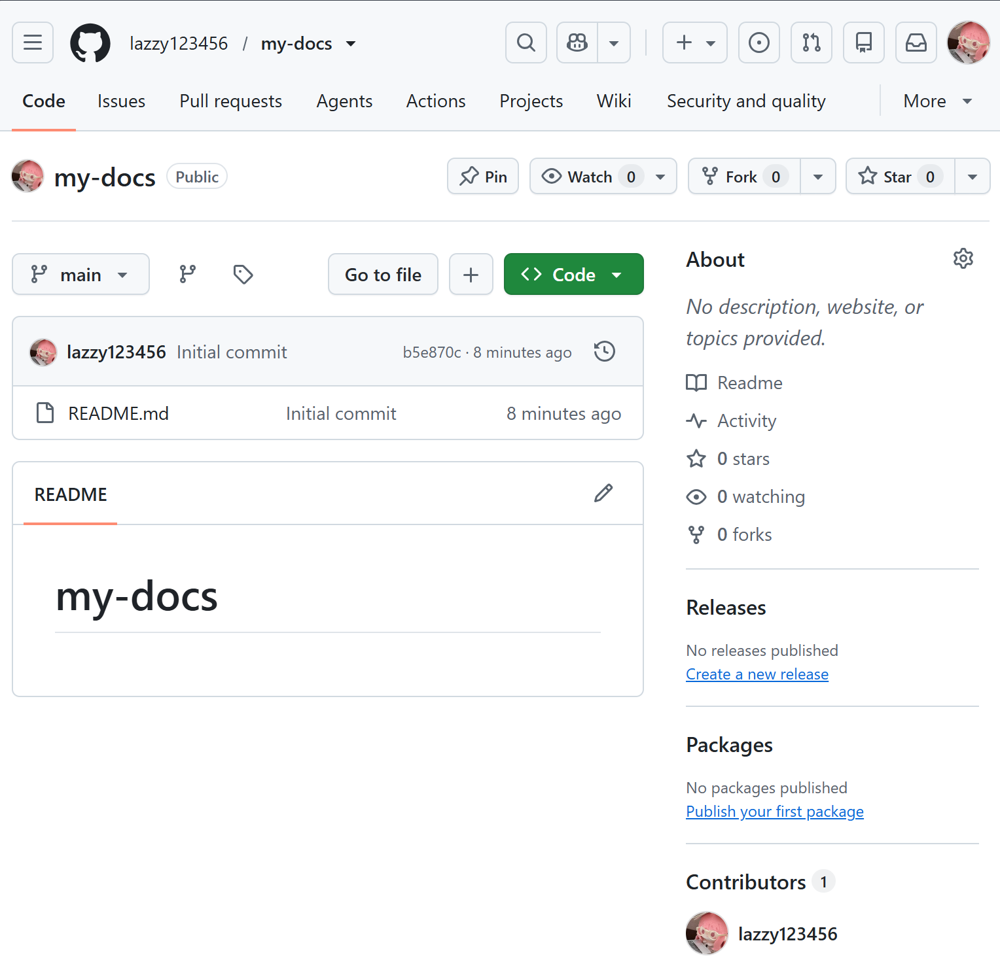

### 2.2 项目结构与 MkDocs 配置
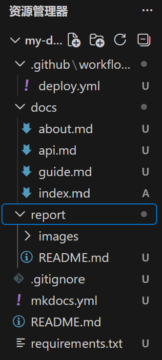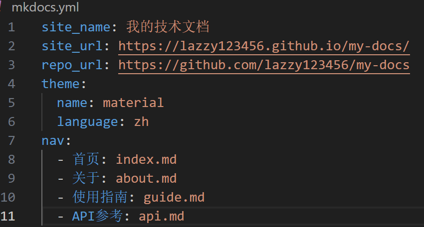
说明：docs存放markdown源文档；nav在mkdocs.yml定义导航栏；site是mkdocs构建输出产物，不提交到git。

### 2.3 本地构建或预览
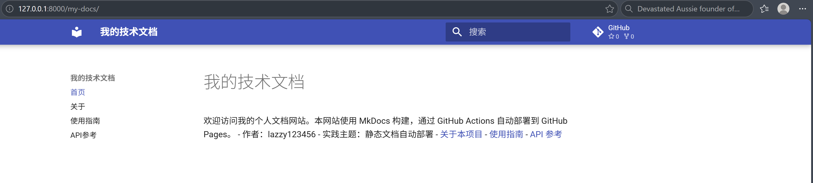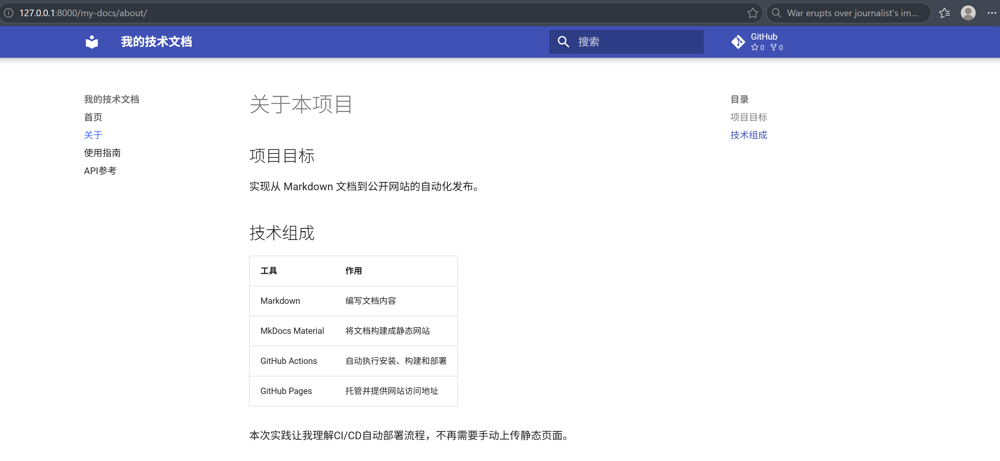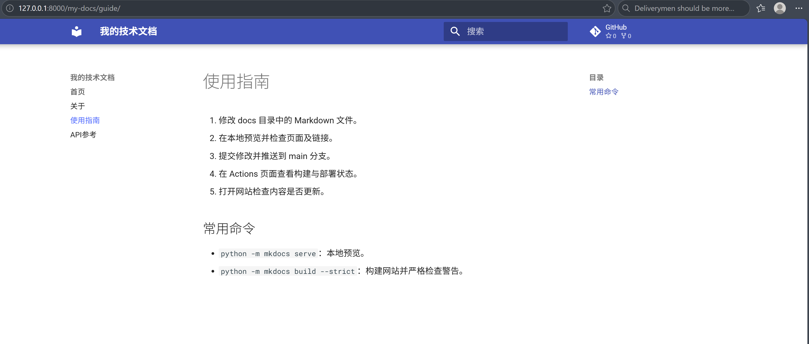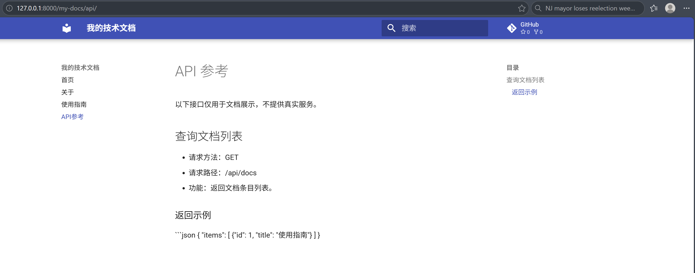
说明：本地启动mkdocs serve，依次检查4个页面、导航链接、表格、代码块是否正常。

### 2.4 Pages 设置
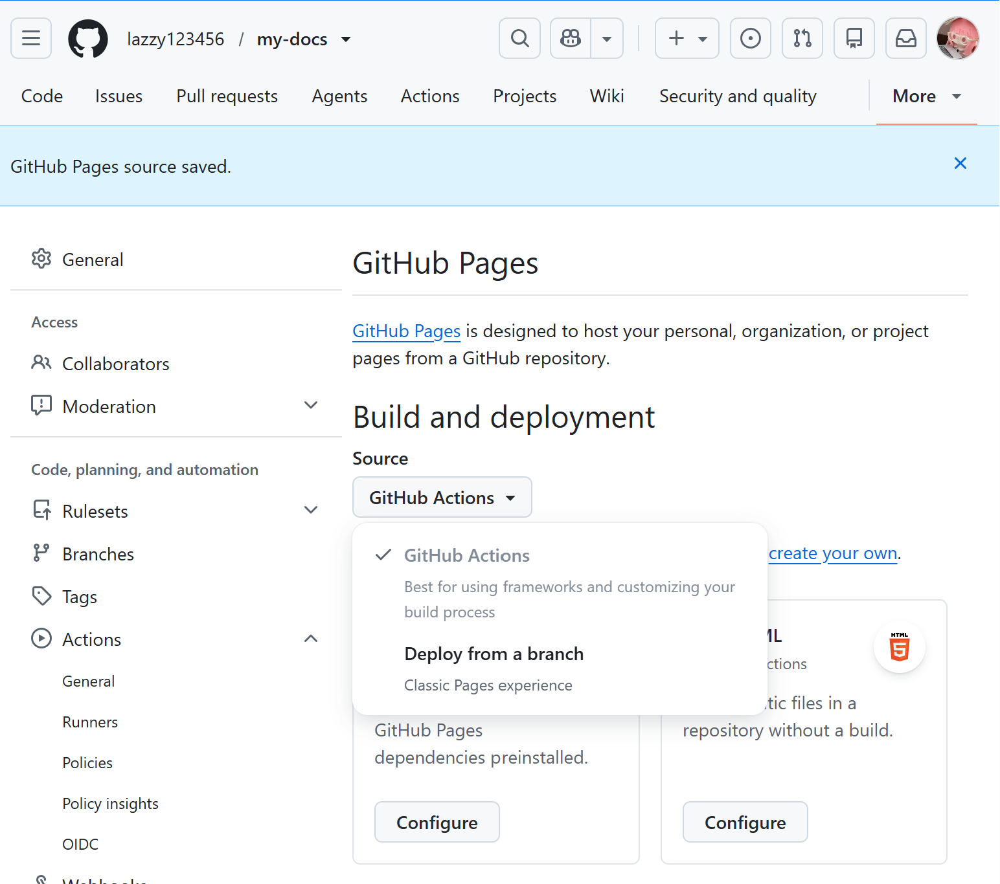
说明：Pages发布来源选择GitHub Actions，使用官方工作流发布。

### 2.5 Actions 首次构建和部署
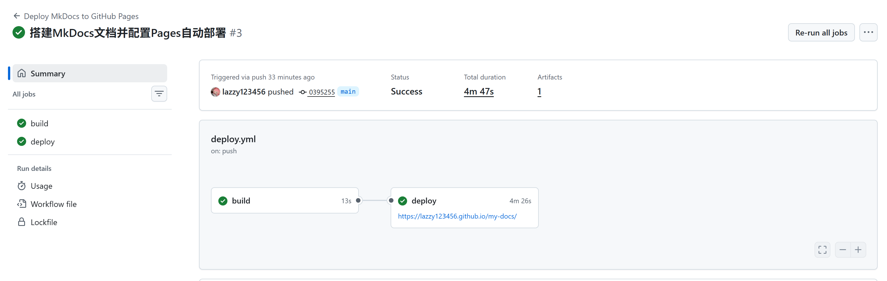
说明：build任务完成mkdocs打包，deploy任务上传发布到pages。

### 2.6 网站访问与四页导航检查
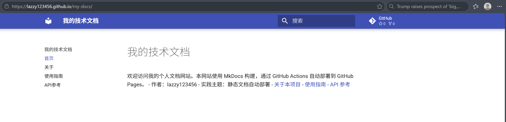
说明：依次打开首页、关于、使用指南、API参考，导航跳转正常，表格代码渲染正常。

### 2.7 第二次推送与自动更新验证
- 对应提交链接：
- 对应 Actions 运行链接：
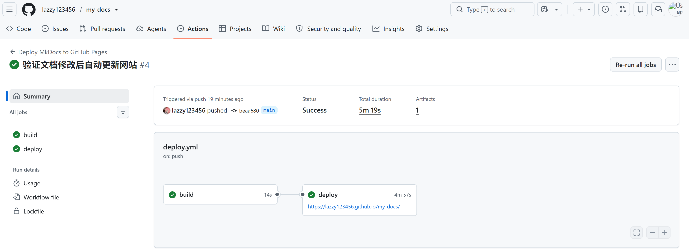
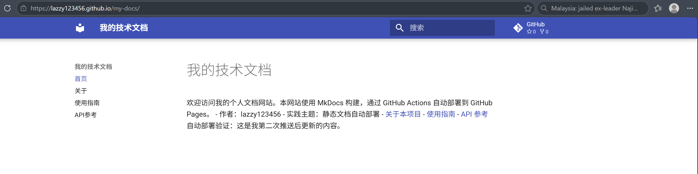

## 3. 问题与解决
全程无报错，核对了action日志、yaml缩进、python版本、pages来源配置。

## 4. 原理理解
1. docs/ 和 site/ 各保存什么？为什么不用手工修改 site/？
docs：手写的Markdown源码；site：mkdocs自动编译生成的静态html。每次build会重新生成site，手动改会被覆盖，不需要提交。
2. 本次工作流在什么情况下自动运行？
push到main分支，并且修改的文件是docs/**、mkdocs.yml、requirements.txt、deploy.yml；也可以手动workflow_dispatch触发。
3. build 与 deploy 两个任务有什么区别？
build：拉源码、装python依赖、mkdocs构建、上传site制品；deploy：拿到制品，部署到github pages服务。needs:build表示构建成功才部署。
4. 只修改report/README.md 会触发部署吗？为什么？
不会。workflow的paths配置只监听docs、mkdocs.yml、requirements.txt、deploy.yml，report不在监听路径里。
5. 本次方案为何无需创建 gh-pages 分支？
使用github官方pages artifact工作流，制品临时上传，直接部署到pages服务，不需要维护独立gh-pages分支。
